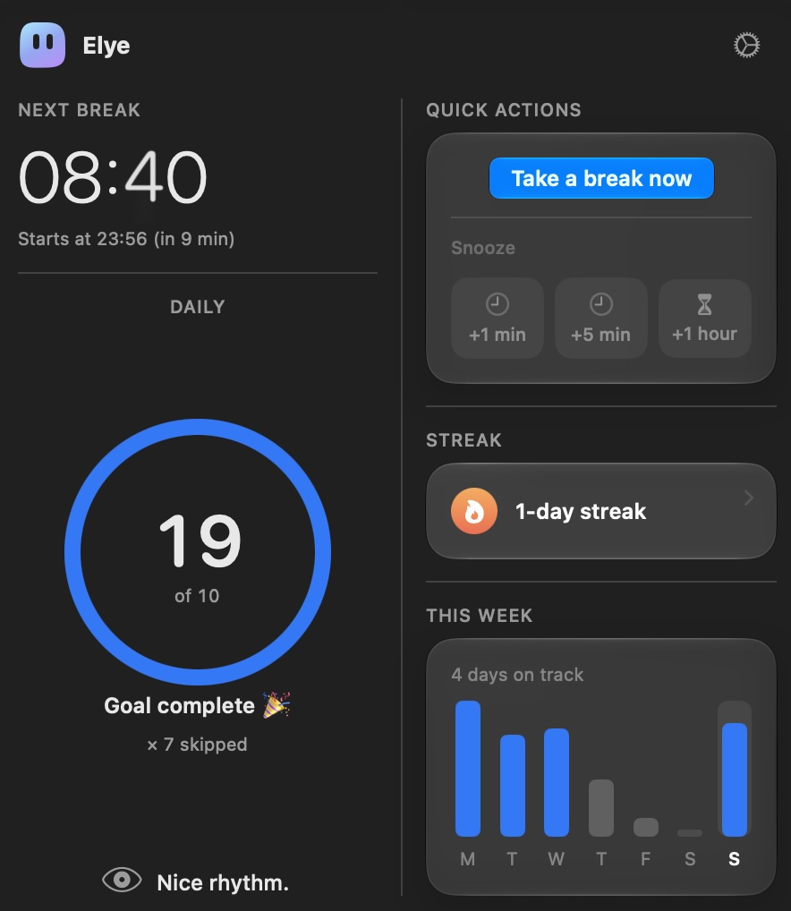
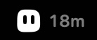
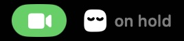

import Sidenote from "../../components/Sidenote.astro";

[Website and 30s film](https://elye.app/)

## Problem

I ended every workday with blurry eyes. I knew the 20-20-20 rule (every 20 minutes, look 20 feet away for 20 seconds), but deep work always won.<Sidenote>Twenty feet is about six metres. Far enough for the eye's focusing muscle to relax.</Sidenote>

I tried LookAway and never adapted to it, and it asks you to pay after seven days. I saw room for something different: a more minimal UI, gentler in tone, focused only on the 20-20-20 rule. It was also a chance to build a native product end to end.

## Hardest design decision: picking the moment

A break habit only forms if the break never becomes an interruption you learn to dismiss. So Elye is not a timer: it picks the moment.

- It holds through calls: camera or mic in use, or a call in a browser tab.
- A due break waits for a pause in your typing (up to 90 seconds).
- A call of 30 minutes or more is followed by a break as it ends.
- Every break comes with a heads-up first.

The blink reminder came from the same idea. Every six focused minutes, when Elye can tell you're looking at the screen, it blinks twice beside your text cursor and in the menu bar. It never appears during a call, a focus hold, or the last three minutes before a break, and it needs no camera. The first three say "Blink with me"; after that, the blink alone is the cue.

## What the first version got wrong

**Breaks arrived abruptly.** A break could land in the middle of a sentence. That led to the heads-up before every break, and to waiting for a pause in your typing.

**Being away counted as rest.** Looking at a phone or another computer doesn't rest your eyes. Now the clock freezes while you're away, and the round only restarts after 5 minutes locked or asleep, or a full interval of quiet.

## How it was built

- **App:** SwiftUI on macOS 26, with Liquid Glass break surfaces. It lives in the menu bar: no window, no dock icon.
- **Brand:** the pause sign `||` worn as two eyes. The eyes carry every mood: they blink while open, close at ease (`◡◡`) while a call holds the break, and turn to `^^` when a break lands. One drawing is shared by the app, the icon and the website.
- **Release:** Conventional Commits drive semantic-release, which versions the app, builds the DMG and publishes a GitHub Release on every push to main.
- **Website:** a waitlist landing page in Next.js and Tailwind on Vercel, with leads going to Notion. It builds SEO and organic reach before launch.
- **Private by default:** no account, no tracking; data stays on the Mac.

## Outcome

Elye isn't public yet. It already solves the problem it was built for: my end-of-day blurry eyes are gone. The waitlist will tell whether the need goes beyond me before the public launch.
