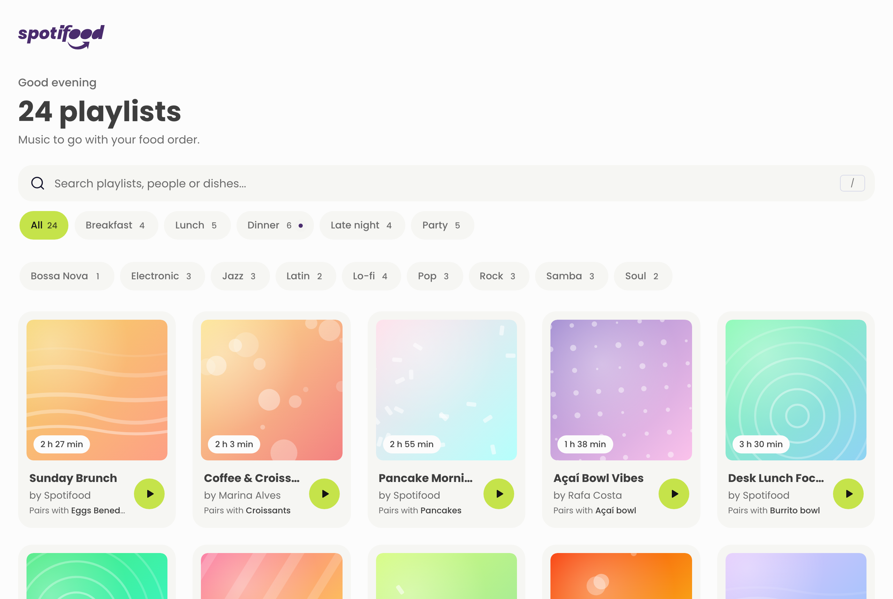
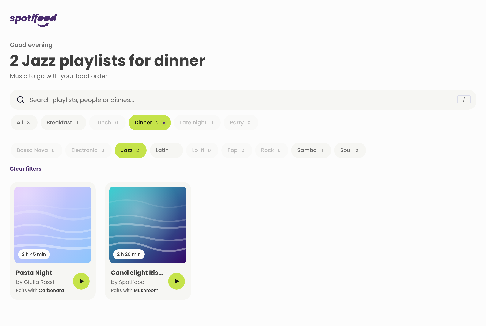
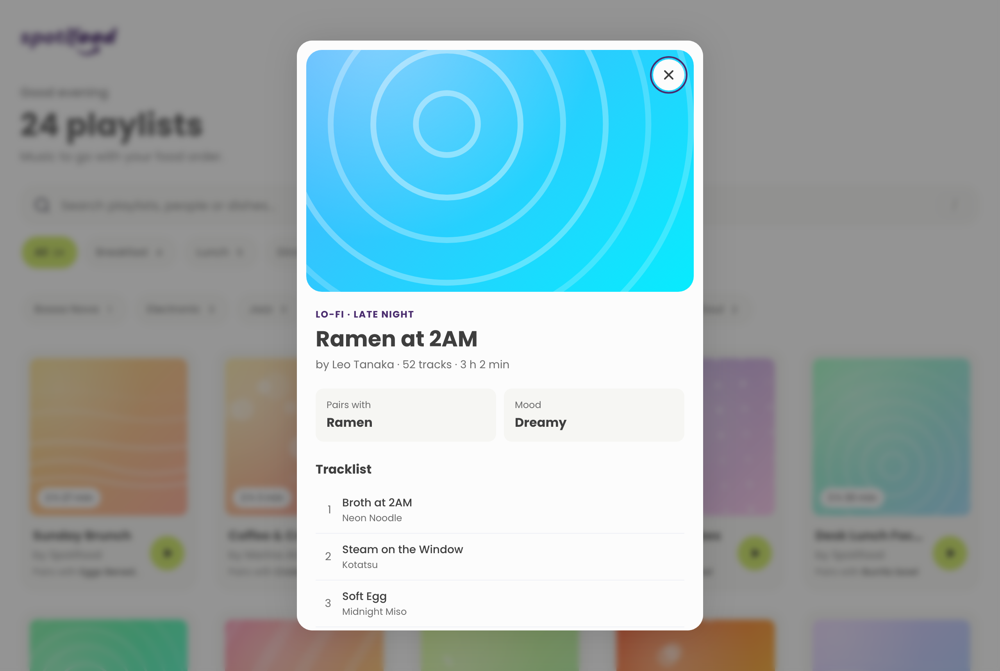
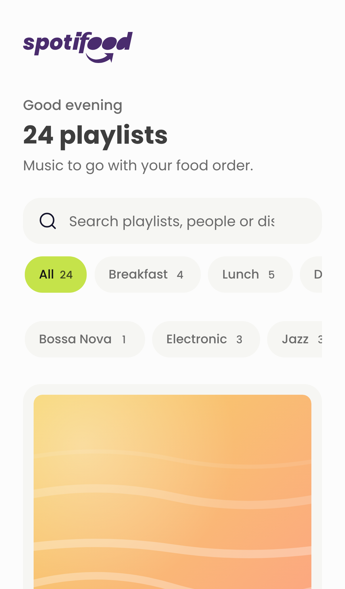
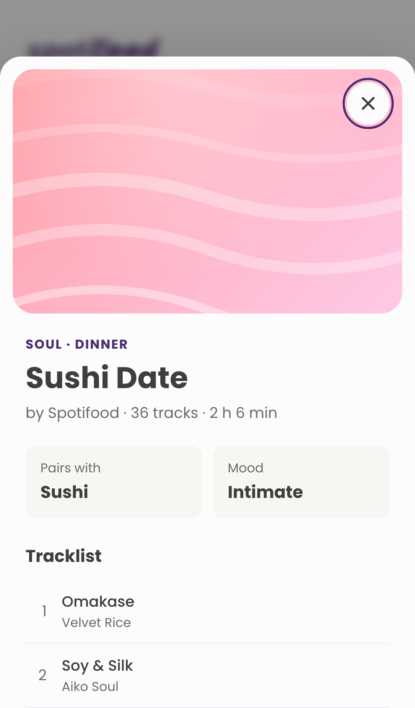

[Live app](https://spotifood-ten.vercel.app) · [Storybook](https://spotifood-components.vercel.app) · [Figma](https://www.figma.com/design/ZYNcMs2B7uDiFCmw9mBvZQ) · [GitHub](https://github.com/emunhoz/spotifood)

## Problem

A playlist browser for food orders: pick the meal, narrow by genre or search for a dish, open a playlist to see its tracks. The 2021 version hid filters behind a "FILTERS" link, a side modal, selects, an "applied filters" row and toasts, and depended on a Spotify login that later stopped working.

## Hardest design decision

**Tokens and components before screens.** I designed the screens in Figma, but in code I didn't start with them: first I pulled the tokens (type scale, spacing, colors) out of the Figma file, then documented every component in Storybook, and only then assembled the pages. The first screen took longer to appear, but every screen after it was built from the same documented pieces, so Figma, Storybook and the app never drifted apart.

## Design decisions

**One job per color.** The old red brand also read as "error", so the main button looked like an alert. Each color now has a single role: basil for actions, aubergine for the brand, red only for errors. Contrast decided the details: text on basil is near-black (12.7:1; white would be 1.45:1).

**Filters on the surface, with no dead ends.** Meal and genre are one tap each, as chips. Every chip shows how many results it would give, and a chip that would return nothing is disabled, so the page never offers an empty result. The selection lives in the URL, so a filtered view can be shared.

**Context that suggests, never decides.** The meal that matches the hour gets a small dot, but the list always starts complete: preselecting it would hide most of the content from someone who just arrived.

**Native motion, 0 kB.** Filtering runs inside a View Transition, and opening a playlist is a container transform: the card grows into the dialog while its cover flies into place. The hard part was layering, found by recording frames at 10× slower speed. Everything is off under `prefers-reduced-motion`.

## How it was built

- **Tokens:** DTCG design tokens, built by Style Dictionary into a typed theme and CSS variables. The same file backs the Figma variables.
- **Figma ↔ code through a pull request:** Tokens Studio pushes token changes to a branch, and CI regenerates the code, runs the tests and opens a PR with a Vercel preview. A color change is reviewed like code.
- **Components:** a library documented in Storybook, consumed by a Vite + React app organized by feature, in a Bun monorepo.
- **Quality:** Vitest, Jest and Testing Library, plus Playwright visual tests on desktop and Pixel 7, and Lighthouse in CI.

## Outcome

- Lighthouse (CI, median of 3): Performance 95, Accessibility 100, Best practices 100, SEO 100.
- Layout shift from 0.05 to 0.01.
- Initial JS from 264 kB to 222 kB (71 kB gzip), with no animation or UI library.
- Decoupled from the Spotify API: the UI reads a versioned JSON through a real `fetch`, so pointing it at a real endpoint is a one-line change.
